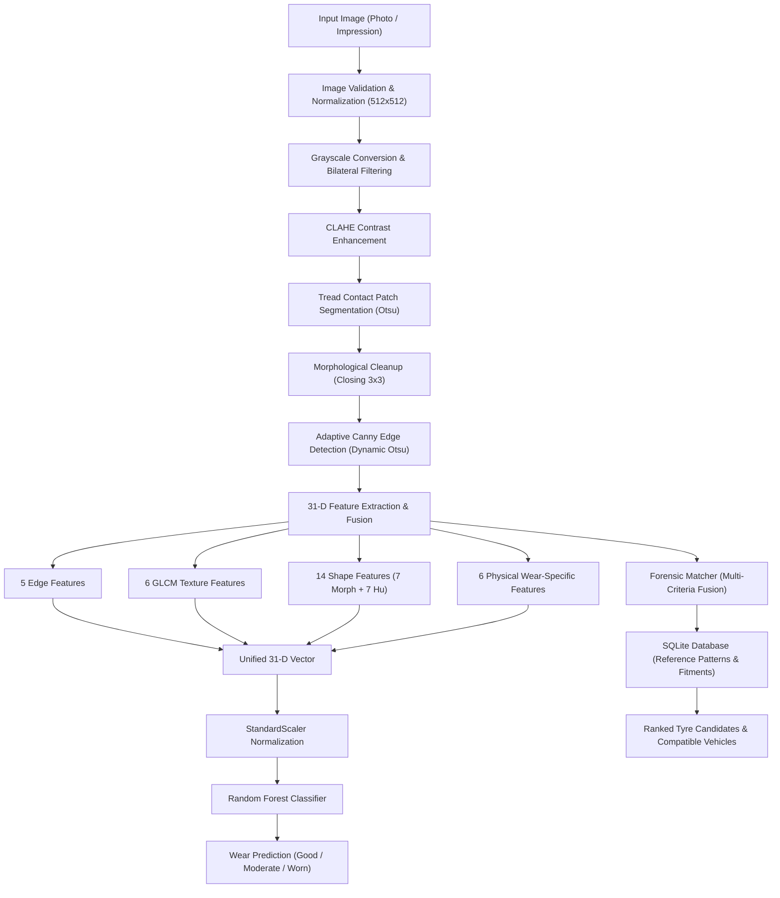

# TreadVision

### Project Title
**TreadVision: Intelligent Tyre Tread Analysis, Forensic Tread Matching and Vehicle Fitment Intelligence Using Image Processing and Machine Learning**

---

## 1. Project Overview

### Problem Statement
Tyre tread patterns provide critical engineering, safety, and forensic information. In automotive maintenance, timely detection of tyre wear is necessary to prevent catastrophic failure, loss of wet braking grip, and legal non-compliance. In criminal and traffic accident investigations, tyre impression evidence recovered from terrain (e.g., mud, soil, dirt, sand) can link crime scenes to specific tyre pattern families and compatible vehicle models. However, manual tread inspection is error-prone, subjective, and reliant on physical gauges, while forensic tread matching often demands laborious manual searching through disparate manufacturer catalogues.

### Project Objectives
1. **Automated Wear State Classification**: Provide objective, transparent image-based classification of tyre wear into Good, Moderate, and Worn states using classical computer vision feature extraction combined with group-aware machine learning.
2. **Forensic Impression Matching**: Enable multi-criteria pattern similarity matching between photographic impressions (including terrain-embedded impressions) and verified manufacturer reference patterns.
3. **Vehicle Fitment Retrieval**: Link identified tyre patterns to verified automotive fitment databases (OEM specifications across manufacturers, models, and production generations).
4. **Predictive Replacement Guidance**: Offer rule-based tyre replacement recommendations based on wear state, legal depth limits (1.6 mm), and vehicle size compatibility.

### Intended Applications
- **Automotive Service Centres & Fleet Management**: Rapid contactless inspection of vehicle tyre health.
- **Forensic & Law Enforcement Workstations**: Investigatory lead generation to narrow down candidate tyre patterns and vehicle models from scene-of-crime tread impressions.
- **Academic Research**: Benchmarking classical feature fusion against physical-tyre leakage in computer vision.

### Scope and Limitations
- **Current Scope**: Evaluated on controlled, calibrated reference tyre imagery across 4 pattern families (Michelin Primacy 4, Continental PremiumContact 6, Bridgestone Turanza T005, Goodyear EfficientGrip) representing 12 physical tyres.
- **Forensic Scope**: Provides investigative similarity screening and lead generation; does not provide individualizing physical evidence.
- **Operational Limitation**: Real-world field deployment requires further validation across uncontrolled illumination, camera optical distortions, heavy road contamination, and physical wear asymmetry.

---

## 2. Core Modules

TreadVision consists of four integrated modules:

```
+-----------------------------------------------------------------------------+
|                                 TreadVision                                 |
+-----------------------------------------------------------------------------+
  |
  +---> [1] Tyre Tread Analyzer
  |         Image-based wear classification (Good / Moderate / Worn)
  |         via 31-D feature fusion and Random Forest inference.
  |
  +---> [2] Tyre Replacement Advisor
  |         Predictive replacement timing, legal depth compliance (1.6 mm),
  |         and size-matched tyre recommendations from verified database.
  |
  +---> [3] Tyre Tread Database
  |         Structured SQLite database storing tyre models, specifications,
  |         precomputed 31-D CV feature vectors, and vehicle fitments.
  |
  +---> [4] Forensic Tread Matcher
            Multi-criteria pattern matching (Edge, Texture, Shape, ORB)
            ranking candidate tyres and identifying compatible vehicles.
```

### Module Descriptions and Interoperation
1. **Tyre Tread Analyzer**: Accepts a photograph of a tyre tread, executes the classical image-processing pipeline, extracts a 31-dimensional feature vector, and passes it to the trained Random Forest classifier. It outputs the predicted wear class, class score distributions, and pattern integrity metrics.
2. **Tyre Replacement Advisor**: Ingests the analyzer's output. If the tyre is classified as Moderate or Worn, it calculates estimated remaining mileage before reaching the 1.6 mm legal limit, recommends urgent or scheduled replacement actions, and queries the database for compatible tyre sizes.
3. **Tyre Tread Database**: Serves as the central repository. It contains relational tables (`tyres`, `tread_patterns`, `tyre_sizes`, `vehicles`, `fitments`, `tread_features`) populated with verified manufacturer specifications and precomputed 31-D computer vision feature vectors.
4. **Forensic Tread Matcher**: Allows forensic investigators to upload crime-scene tyre impressions (with optional 4-point perspective rectification). It computes multi-criteria similarity against all database reference tyres, producing a ranked list of candidates and displaying all compatible vehicle models.

---

## 3. System Architecture

The production architecture enforces a separation between feature extraction, statistical classification, and forensic similarity querying:



### Forensic Matching & Database Interaction
Forensic matching operates as a parallel pipeline:
- It processes query impressions through perspective rectification and CLAHE enhancement.
- It computes bounded L1 distances on edge, texture, and shape descriptors against stored `tread_features` records in SQLite.
- It performs ORB keypoint extraction and Lowe's ratio test matching on reference images.
- Candidate tyres are ranked by overall similarity score, and relational SQL queries immediately retrieve all linked vehicle fitments from `vehicles` and `fitments` tables.

---

## 4. Image Processing Pipeline

The image-processing pipeline is implemented in [`app/image_processing/pipeline.py`](file:///c:/Users/puru/Desktop/IP-Event/app/image_processing/pipeline.py). It operates entirely via transparent, classical computer vision:

1. **Image Validation & Resize**: Validates file integrity, dimensions, and color space; standardizes resolution to $512 \times 512$ while preserving aspect ratio.
2. **Grayscale Conversion**: Eliminates color dependencies:
   $$Y = 0.299 \cdot R + 0.587 \cdot G + 0.114 \cdot B$$
3. **Bilateral Filtering**: Smooths sensor noise and asphalt grain while preserving sharp groove boundaries ($d=9, \sigma_r=75, \sigma_s=75$):
   $$I^{\text{filtered}}(x) = \frac{1}{W_p} \sum_{x_i \in \Omega} I(x_i) \exp\left(-\frac{\|x_i - x\|^2}{2\sigma_s^2}\right) \exp\left(-\frac{\|I(x_i) - I(x)\|^2}{2\sigma_r^2}\right)$$
4. **Contrast Enhancement (CLAHE)**: Divides the image into $8 \times 8$ contextual tiles, applies contrast limiting ($\text{clip}=2.0$) to prevent noise amplification, and blends tile boundaries via bilinear interpolation.
5. **Tread Region Segmentation**: Employs Otsu's global bi-level thresholding to separate tyre rubber contact patches from background voids by maximizing between-class variance:
   $$\sigma_b^2(t) = \omega_0(t)(\mu_0(t) - \mu_T)^2 + \omega_1(t)(\mu_1(t) - \mu_T)^2$$
6. **Morphological Cleanup**: Applies mathematical closing with a $3 \times 3$ rectangular structuring element ($A \bullet B = (A \oplus B) \ominus B$) to bridge minor intra-rib micro-voids.
7. **Adaptive Canny Edge Detection**: Detects structural groove edges and sipes.

### Why Adaptive Canny Was Introduced
In Phase 3 robustness testing, the legacy Fixed Canny baseline ($T_{\text{low}}=50, T_{\text{high}}=150$) was found to suffer from **catastrophic threshold extinction**:
- Under optical defocus or contrast reduction, the gradient magnitude of shallow worn grooves dropped below 50.
- Consequently, Fixed Canny detected **0 edges** for worn tyres, leading to complete morphological failure.
- The **Gradient Otsu Adaptive Canny** dynamically calculates:
  $$|\nabla I| = \sqrt{I_x^2 + I_y^2}$$
  $$T_{\text{high}} = \text{clip}\left(\frac{T_{\text{otsu}}(|\nabla I|)}{255} \cdot \max(|\nabla I|),\, 40,\, 220\right), \quad T_{\text{low}} = \text{clip}\left(0.40 \cdot T_{\text{high}},\, 15,\, 120\right)$$
- Under low contrast and optical blur, it automatically lowers thresholds to $[18, 45]$, maintaining edge continuity and preventing failure while bounding the lower threshold ($T_{\text{low}} \ge 15$) to prevent noise amplification.

---

## 5. Feature Extraction (31-D Vector Specification)

The feature extraction engine ([`app/image_processing/feature_fusion.py`](file:///c:/Users/puru/Desktop/IP-Event/app/image_processing/feature_fusion.py)) outputs a standardized 31-dimensional floating-point vector:

| Index | Category | Feature Name | Description |
| :---: | :--- | :--- | :--- |
| `0` | Edge | `edge_total_density` | Structural groove pixels / total contact area |
| `1` | Edge | `edge_horiz_density` | Circumferential edge pixels ($\theta \in [60^\circ, 120^\circ]$) / total area |
| `2` | Edge | `edge_vert_density` | Transverse lateral edge pixels ($\theta \le 30^\circ \lor \theta \ge 150^\circ$) / area |
| `3` | Edge | `edge_orient_mean` | Mean edge gradient orientation in degrees ($[0^\circ, 180^\circ]$) |
| `4` | Edge | `edge_orient_std` | Standard deviation of edge orientation angles |
| `5` | Texture | `texture_contrast` | GLCM intensity contrast between adjacent pixels |
| `6` | Texture | `texture_dissimilarity` | GLCM linear difference metric |
| `7` | Texture | `texture_homogeneity` | GLCM inverse difference moment ($[0, 1]$) |
| `8` | Texture | `texture_energy` | GLCM angular second moment root ($[0, 1]$) |
| `9` | Texture | `texture_correlation` | GLCM linear dependency between neighboring pixels ($[-1, 1]$) |
| `10` | Texture | `texture_asm` | GLCM Angular Second Moment |
| `11` | Shape | `shape_area_ratio` | Contact patch area / bounding box area |
| `12` | Shape | `shape_perimeter_ratio` | Contact perimeter / bounding perimeter |
| `13` | Shape | `shape_aspect_ratio` | Contact patch bounding width / height |
| `14` | Shape | `shape_extent` | Contact area / bounding box rectangle area |
| `15` | Shape | `shape_solidity` | Contact area / convex hull area |
| `16` | Shape | `shape_circularity` | Isoperimetric quotient: $4\pi \cdot \text{Area} / \text{Perimeter}^2$ |
| `17` | Shape | `shape_equiv_diameter` | Diameter of circle with equivalent area / image diagonal |
| `18` | Hu Moment | `hu_moment_1` | 1st log-transformed invariant moment (inertia spread) |
| `19` | Hu Moment | `hu_moment_2` | 2nd log-transformed invariant moment |
| `20` | Hu Moment | `hu_moment_3` | 3rd log-transformed invariant moment |
| `21` | Hu Moment | `hu_moment_4` | 4th log-transformed invariant moment |
| `22` | Hu Moment | `hu_moment_5` | 5th log-transformed invariant moment |
| `23` | Hu Moment | `hu_moment_6` | 6th log-transformed invariant moment |
| `24` | Hu Moment | `hu_moment_7` | 7th log-transformed invariant moment (skewness/chirality) |
| `25` | Wear-Specific | `groove_to_land_contrast` | Michelson contrast: $(I_{\text{land}} - I_{\text{groove}}) / (I_{\text{land}} + I_{\text{groove}})$ |
| `26` | Wear-Specific | `groove_visibility_ratio` | Valley prominence normalized by dynamic range ($p_{95} - p_{05}$) |
| `27` | Wear-Specific | `sipe_visibility_freq` | High-frequency vertical/angled gradient density in land zones |
| `28` | Wear-Specific | `local_groove_continuity` | Normalized maximum vertical continuous corridor fraction |
| `29` | Wear-Specific | `local_texture_contrast` | Average standard deviation within $32 \times 32$ block land regions |
| `30` | Wear-Specific | `groove_wall_gradient` | Mean lateral gradient slope at groove-to-land transition boundaries |

---

## 6. Machine Learning Architecture

### Classifier Configuration
- **Algorithm**: Random Forest Classifier ([`app/ml/models.py`](file:///c:/Users/puru/Desktop/IP-Event/app/ml/models.py))
- **Hyperparameters**:
  - `n_estimators`: 150
  - `max_depth`: 10
  - `min_samples_split`: 2
  - `random_state`: 42
- **Feature Scaling**: Standard z-score normalization (`StandardScaler`) fitted strictly on training data folds to prevent data leakage.

### Training & Inference Parity
The 6 wear-specific features and 25 baseline features are generated using the exact same preprocessing and fusion routine in both training ([`WearDataset.build_feature_matrix()`](file:///c:/Users/puru/Desktop/IP-Event/app/ml/dataset.py)) and inference ([`WearInferenceEngine.predict()`](file:///c:/Users/puru/Desktop/IP-Event/app/ml/inference.py)). Numerical parity is verified by automated regression test [`test_training_inference_feature_parity`](file:///c:/Users/puru/Desktop/IP-Event/tests/test_pipeline.py).

### Probability Interpretation Notice
> **Statistical Clarification**: In accordance with machine learning integrity principles, Random Forest class probability outputs (`predict_proba`) represent **tree ensemble vote fractions** (the proportion of decision trees voting for a specific class), not empirically calibrated Bayesian probabilities. They should not be interpreted as posterior probabilities without Platt scaling or isotonic regression calibration.

### Model Serialization & Artifacts
Production artifacts are serialized with `joblib` into [`models/`](file:///c:/Users/puru/Desktop/IP-Event/models):
- `wear_classifier_rf.joblib`: Trained Random Forest model (`n_features_in_ == 31`).
- `scaler.joblib`: Trained StandardScaler (`n_features_in_ == 31`).
- `label_encoder.joblib`: Scikit-Learn LabelEncoder mapping `["good", "moderate", "worn"]`.
- `metrics_rf.json`: Detailed production evaluation metrics and audit history.

### Legacy 25-D Rollback Support
Prior to 31-D deployment, the legacy 25-D models were archived in [`models_legacy_25d/`](file:///c:/Users/puru/Desktop/IP-Event/models_legacy_25d). The rollback test suite ([`tests/test_rollback.py`](file:///c:/Users/puru/Desktop/IP-Event/tests/test_rollback.py)) confirms that:
- The 25-D model and scaler can be loaded on-demand.
- The inference engine detects vector dimension mismatches and prevents matrix corruption.

---

## 7. Experimental Development (Phases 1–4)

The production configuration was developed through four experimental phases:

### Phase 1: Synthetic Dataset Realism
- **Problem**: The original baseline generator used an integer-rounding step for sipe thickness that resulted in identical sipe geometry for Good and Moderate tyres, while Worn tyres suffered from an artificial zero-edge bug.
- **Intervention**: Implemented continuous degradation of sipe width and depth; progressive relief attenuation for longitudinal grooves; and non-zero residual groove boundaries for Worn tyres.
- **Result**: Restored physical monotonicity across wear states and resolved artificial data artifacts.

### Phase 2: Wear-Specific Feature Augmentation
- **Investigation**: Evaluated 6 new local wear descriptors capturing groove-land contrast and sipe density independently of macro tread pattern geometry.
- **Findings**:
  - Configuration A (25-D Baseline): RF CV Acc $96.3\% \pm 5.2\%$, SVM fold variance $0.0198$.
  - Configuration B (31-D Augmented): Maintained $100\%$ holdout accuracy, reduced SVM cross-validation fold variance by **75%** ($0.0050$), and boosted KNN accuracy by **11.1%**.
  - Configuration C (6-D Wear-Only): Proved that local relief alone is insufficient without macro geometric context ($88.9\%$ holdout).
- **Decision**: Adopted Configuration B (31-D) as the preferred feature architecture.

### Phase 3: Adaptive Canny Edge Detection
- **Investigation**: Compared Fixed Canny ($50, 150$) against Gradient Otsu Adaptive Canny across 6 stress conditions (nominal, darkened, brightened, low contrast, sensor noise, optical blur).
- **Findings**:
  - On nominal clean images, Fixed and Adaptive Canny produced identical edge distributions ($r > 0.999$).
  - Under low contrast ($0.75\times$) and mild Gaussian blur ($\sigma=1.1$), Fixed Canny suffered **complete catastrophic failure (0 edges detected)** on worn tyres.
  - Adaptive Canny automatically lowered thresholds to $[18, 45]$, maintaining edge continuity without noise amplification.
- **Decision**: Adopted Adaptive Canny in the production pipeline.

### Phase 4: Pattern-Conditioned Normalization Evaluation
Tested four pattern-conditioned normalization strategies to determine if pattern dependence could be eliminated:
- **Config D1 (In-Fold Z-Score Normalization)**: **Failed catastrophically**. RF CV accuracy collapsed from $96.3\%$ to **$51.9\% \pm 26.2\%$**, and SVM collapsed to **$25.9\%$**. Reason: Group-aware folds have incomplete wear representations per pattern; centering by incomplete class distributions creates severe distribution shift.
- **Config D3 (OEM Catalogue Reference Ratio)**: **Failed**. CV accuracy fell to **$77.8\%$**, with between-pattern variance at Moderate increasing by **143%**. Reason: Different patterns follow non-linear wear curves; dividing by unworn values causes Moderate and Worn states of different patterns to overlap.
- **Config D2 (Data-Driven Ratio)**: Relied on fragile fallbacks when training folds lacked unworn samples.
- **Config D4 (Pattern Indicator Augmentation)**: Achieved $100\%$ CV accuracy with graceful fallback, but retained in experimental branches pending validation on unseen pattern families.
- **Decision**: **Rejected D1, D2, D3, and D4 from default production**. The unconditioned 31-D feature space remains the most robust production architecture.

---

## 8. Model Evaluation & Production Metrics

### Evaluation Protocol
- **Dataset**: 36 controlled reference images representing 12 distinct physical tyre units across 4 pattern families.
- **Outer Split**: StratifiedGroupKFold (4-fold outer split): 27 training images (9 physical tyres) and 9 held-out testing images (3 physical tyres: `tyre_g04`, `tyre_m02`, `tyre_w03`).
- **Inner Validation**: 3-fold StratifiedGroupKFold cross-validation on the 9 training physical tyres (zero physical-tyre leakage across all validation folds).

### Production Evaluation Metrics (Random Forest)
- **Held-Out Test Accuracy**: **100.0%** (9/9 views)
- **Held-Out Weighted F1-Score**: **1.0000**
- **3-Fold Inner Group CV Mean Accuracy**: **96.30%** (Fold scores: $0.8889, 1.0000, 1.0000$)
- **3-Fold Inner Group CV Mean F1**: **0.9619**
- **Leakage Check**: **PASSED** ($\text{Train Tyres} \cap \text{Test Tyres} = \emptyset$)

### Confusion Matrix (Held-Out Test Set: 9 Views)
```
                    Predicted Good   Predicted Moderate   Predicted Worn
Actual Good (g04)         3                  0                  0
Actual Moderate (m02)     0                  3                  0
Actual Worn (w03)         0                  0                  3
```

### Distinction Between Metric Sets
1. **Earlier Exploratory 3-Fold Results**: Experimental runs conducted during Phase 2 and Phase 4 in isolated harnesses to compare candidate architectures.
2. **Production 4-Fold Group Split**: The operational training protocol implemented in `app/ml/train.py`, validating holdout generalization on 3 completely unseen physical tyres.
3. **Live Smoke Tests**: Verification that end-to-end execution of `ImageProcessingPipeline` and `WearInferenceEngine` operates within 32–47 ms per frame.

### Mandatory Dataset Limitation Notice
> [!IMPORTANT]
> **Dataset Limitation**: Current classifier validation is based on controlled reference images (36 images across 12 physical tyres). The held-out test set contains 9 views from 3 physical tyres. **The reported 100% test accuracy reflects separation on this calibrated reference set and must never be interpreted as guaranteed real-world field accuracy.** Real-world performance requires validation against independently collected physical tyre photographs across diverse manufacturers, ambient lighting, camera sensors, viewing angles, and road wear conditions.

---

## 9. Forensic Tread Matching

The forensic matching engine ([`app/image_processing/forensic_matcher.py`](file:///c:/Users/puru/Desktop/IP-Event/app/image_processing/forensic_matcher.py)) matches photographic tyre impressions (e.g., crime-scene impressions in mud, soil, dirt, or sand) against verified reference patterns.

### Multi-Criteria Similarity Formulation
$$\mathcal{S}_{\text{overall}} = \frac{w_e \cdot \mathcal{S}_{\text{edge}} + w_t \cdot \mathcal{S}_{\text{texture}} + w_s \cdot \mathcal{S}_{\text{shape}} + w_l \cdot \mathcal{S}_{\text{local}}}{w_e + w_t + w_s + w_l}$$

- **Edge Similarity ($\mathcal{S}_{\text{edge}}$, weight $0.30$)**: Bounded L1 distance on edge density and horizontal/vertical directional orientation.
- **Texture Similarity ($\mathcal{S}_{\text{texture}}$, weight $0.25$)**: Bounded L1 difference across 6 normalized GLCM texture properties.
- **Shape Similarity ($\mathcal{S}_{\text{shape}}$, weight $0.25$)**: Bounded distance across solidity, circularity, area ratio, and 7 invariant Hu moments.
- **Local Keypoint Similarity ($\mathcal{S}_{\text{local}}$, weight $0.20$)**: Scale-space FAST keypoint detection with oriented BRIEF descriptors (ORB) and Lowe's ratio test matching.
- **Renormalization**: If local keypoints are insufficient (e.g., eroded or muddy impressions), $w_l$ is dropped and remaining weights renormalize to $1.0$.

### Forensic Disclaimer
> [!WARNING]
> **Forensic Notice**: TreadVision provides image-based pattern similarity screening for research, investigative lead generation, and educational purposes. A similarity result **does not establish definitive vehicle identification or prove that a particular vehicle or tyre was present at a crime scene**. It must not be treated as definitive forensic evidence without professional physical forensic examination, calibrated photogrammetric evidence, and documented chain of custody.

---

## 10. Technology Stack

- **Language & Runtime**: Python 3.10+ (Tested on Python 3.14.7, 64-bit Windows)
- **Computer Vision**: OpenCV (`opencv-python` $\ge 4.8.0$), Scikit-Image (`scikit-image` $\ge 0.21.0$)
- **Machine Learning & Statistics**: Scikit-Learn (`scikit-learn` $\ge 1.3.0$), SciPy (`scipy` $\ge 1.10.0$), NumPy (`numpy` $\ge 1.24.0$)
- **Data Engineering**: Pandas (`pandas` $\ge 2.0.0$), SQLAlchemy (`SQLAlchemy` $\ge 2.0.0$), SQLite3
- **User Interface**: Streamlit (`streamlit` $\ge 1.30.0$) with dark automotive workstation theme
- **Model Persistence**: Joblib (`joblib` $\ge 1.3.0$)
- **Quality Assurance**: Pytest (`pytest` $\ge 7.0.0$)

---

## 11. Installation and Setup

### Prerequisites
- Windows 10/11 (or Linux / macOS)
- Python 3.10 or higher
- Git

### 1. Clone the Repository
```powershell
git clone <repository-url>
cd IP-Event
```

### 2. Create and Activate Virtual Environment
```powershell
python -m venv .venv
.venv\Scripts\Activate.ps1
```

### 3. Install Dependencies
```powershell
pip install -r requirements.txt
```

### 4. Initialize and Seed the Database
```powershell
python -m app.database.importer --seed
```
This initializes `data/database/treadvision.db` and populates tyres, fitments, and precomputed 31-D feature vectors.

### 5. Verify or Retrain Machine Learning Models
```powershell
python -c "from app.ml.train import ModelTrainer; ModelTrainer().run_training_pipeline('rf')"
```

---

## 12. Running the Application

Launch the Streamlit workstation using the launcher script:
```powershell
python run.py
```
Or directly via Streamlit:
```powershell
streamlit run app/main.py --theme.base=dark
```

The application opens at `http://localhost:8501` featuring the dark technical automotive workstation theme.

---

## 13. Running Tests

Run the complete automated test suite:
```powershell
pytest -v
```

### Test Suite Structure (28 Passing Tests)
- `tests/test_pipeline.py` (12 tests): Validates individual image-processing stages, adaptive Canny bounds, 31-D feature fusion, wear-specific descriptors, and training/inference numerical parity.
- `tests/test_database.py` (4 tests): Validates database schema, foreign keys, relationship mapping, and 31-D feature vector JSON deserialization.
- `tests/test_forensic.py` (5 tests): Validates multi-criteria similarity math, ORB keypoint matching, and missing-feature weight renormalization.
- `tests/test_ml_validation.py` (3 tests): Validates zero physical-tyre leakage in train/test splits, cross-validation isolation, and anti-leakage guards.
- `tests/test_rollback.py` (4 tests): Validates legacy 25-D model archive presence, 25-D scaler dimensions, rollback inference, and dimension mismatch guards.

---

## 14. Project Structure

```
IP-Event/
├── app/
│   ├── __init__.py
│   ├── config.py                       # Global paths, wear classes, thresholds
│   ├── main.py                         # Streamlit application entrypoint
│   ├── database/
│   │   ├── connection.py               # SQLite engine and integrity checks
│   │   ├── models.py                   # SQLAlchemy ORM models (Tyre, Fitment, etc.)
│   │   ├── seed_data.py                # Database seeder with 31-D feature caching
│   │   └── importer.py                 # CLI database importer and verification
│   ├── image_processing/
│   │   ├── preprocessing.py            # Validation, resize, grayscale, noise reduction
│   │   ├── enhancement.py              # CLAHE contrast enhancement
│   │   ├── segmentation.py             # Otsu tread contact-patch segmentation
│   │   ├── morphology.py               # Morphological closing and cleanup
│   │   ├── edges.py                    # Adaptive Canny and Sobel orientation
│   │   ├── texture.py                  # GLCM texture extraction (6 descriptors)
│   │   ├── shape.py                    # 7 morphological descriptors + 7 Hu moments
│   │   ├── wear_features.py            # 6 wear-specific local descriptors (31-D)
│   │   ├── feature_fusion.py           # Unified 31-D vector assembly
│   │   ├── pipeline.py                 # End-to-end ImageProcessingPipeline
│   │   └── forensic_matcher.py         # Multi-criteria similarity matching engine
│   ├── ml/
│   │   ├── dataset.py                  # Anti-leakage StratifiedGroupKFold dataset loader
│   │   ├── models.py                   # Model factory (Random Forest, SVM, KNN)
│   │   ├── train.py                    # ModelTrainer and group-aware cross-validation
│   │   └── inference.py                # WearInferenceEngine with dimension guard
│   ├── recommender/
│   │   └── replacement_advisor.py      # Tread depth checks & safety rules
│   └── ui/
│       ├── theme.py                    # Dark technical workstation color system
│       ├── components.py               # Technical UI components & metrics cards
│       ├── analyzer.py                 # Tread analyzer screen
│       ├── replacement.py              # Replacement advisor screen
│       ├── database_view.py            # Tyre & vehicle catalogue explorer
│       ├── forensic_view.py            # Forensic impression matcher screen
│       └── home.py                     # Workstation dashboard
├── data/
│   ├── database/
│   │   └── treadvision.db              # SQLite relational database
│   └── raw/
│       ├── forensic/                   # Crime-scene impressions & reference scans
│       └── tyre_wear/                  # 36 calibrated reference tyre images
├── experiments/                        # Phase 1-4 experimental scripts & artifacts
│   ├── artifacts/                      # JSON results for Phase 2, 3, and 4
│   ├── phase1_evaluation.py
│   ├── wear_features_diagnostic.py
│   ├── phase2_experiment.py
│   ├── audit_phase2_validation.py
│   ├── phase3_experiment.py
│   └── phase4_experiment.py
├── models/                             # Active 31-D production models
│   ├── wear_classifier_rf.joblib
│   ├── scaler.joblib
│   ├── label_encoder.joblib
│   └── metrics_rf.json
├── models_legacy_25d/                  # Archived 25-D models for rollback
├── scripts/
│   └── generate_demo_assets.py         # Calibrated synthetic asset generator
├── tests/                              # Pytest test suite (28 passing tests)
│   ├── test_pipeline.py
│   ├── test_database.py
│   ├── test_forensic.py
│   ├── test_ml_validation.py
│   └── test_rollback.py
├── .gitignore                          # Clean exclusions
├── pytest.ini                          # Test configuration
├── requirements.txt                    # Python dependencies
└── run.py                              # Desktop launcher script
```

---

## 15. Future Improvements

1. **Independent Real-World Dataset Collection**: Collect diverse physical tyre photographs across road environments, handheld smartphone sensors, optical angles, and natural lighting.
2. **Expansion of Tyre Patterns & Vehicle Models**: Broaden reference catalogue from 4 pattern families to commercial tyre lines across European, Asian, and American markets.
3. **Forensic Information Retrieval Metrics**: Benchmark forensic impression retrieval using Precision@K, Mean Reciprocal Rank (MRR), and Cumulative Match Characteristic (CMC / Rank-1) curves.
4. **Explainable AI (XAI)**: Implement Grad-CAM or Shapley feature attribution overlays to highlight the physical tyre ribs contributing to wear classification decisions.
5. **Pattern-Conditioned Normalization with Unseen Patterns**: Re-evaluate auxiliary pattern conditioning (Config D4) once larger datasets containing dozens of distinct tread geometries become available.
